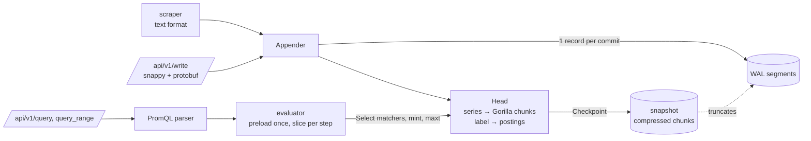

# chronoshard

A small Prometheus-compatible time-series database in Go. It stores samples as Gorilla-compressed chunks, makes them durable with a WAL plus snapshots, indexes series by label, and answers PromQL over the Prometheus HTTP API. On the PromQL subset it implements, its results are **bit-for-bit identical to Prometheus 3.15.1**: 2,350 of 2,350 differential comparisons.

[](https://github.com/eshaan2418/chronoshard/actions/workflows/ci.yml)
[](LICENSE)


## Why this exists

Prometheus is the standard for metrics, but its TSDB and PromQL engine are large and heavily optimized. They are hard to read when you want to understand *why* `rate()` returns what it returns, or how a few bytes can store a sample. chronoshard is the whole pipeline in about 3,600 lines of Go: ingestion, compression, durability, indexing and query evaluation. It is not checked against my own reading of the docs. It is checked against Prometheus itself: the same samples are pushed to both, the same queries run on both, and CI fails if a single value differs. It also works in practice: point Grafana or `promtool` at it, or have it scrape exporters directly.

## Highlights

- **Differentially tested against real Prometheus.** `scripts/conformance.sh` generates a workload with counter resets, gauges, scrape jitter, gaps and series churn, and pushes it to both systems via remote write. It then compares 47 queries, each evaluated at 4 instants and as a range query. Results over 10 seeds: [`bench/results/conformance/`](bench/results/conformance/).
- **Exact Prometheus semantics where they are subtle.** `rate`/`increase` use Prometheus' extrapolation, with its counter-reset correction and its exact order of operations. Lookback and range windows are left-open, as in Prometheus 3. The rules for when `__name__` is dropped are matched, `on`/`ignoring` set the result labels the way Prometheus does, and `topk`/`bottomk` break ties identically by replicating Prometheus' heap.
- **Gorilla compression.** Timestamps are stored as delta-of-deltas in 1/14/17/20/64-bit buckets, so a regular scrape costs one bit. Values are XOR-encoded, reusing the previous leading/trailing-zero window. A realistic gauge takes 2.63 bytes per sample in the unit test, against 16 raw.
- **Durability.** A CRC-framed WAL is replayed on startup, stopping at a torn tail. Periodic snapshots store the compressed chunks and truncate the WAL, written to a temp file, fsynced, renamed, and the directory fsynced.
- **Ingestion** runs at 18 M samples/s in memory and 17 M with the WAL (4 appenders, M5 Pro). Remote write 1.0 is decoded without generated protobuf code.
- **Inverted label index.** Sorted postings are intersected and unioned for `=`, `!=`, `=~` and `!~`, with correct empty-label semantics: `{foo=""}` matches series without `foo`.

## Quick start

Requires Go 1.24 or newer. Running the differential test also needs `prometheus` on your PATH (`brew install prometheus`, or a [release tarball](https://github.com/prometheus/prometheus/releases)).

```sh
git clone https://github.com/eshaan2418/chronoshard && cd chronoshard
make build test          # binaries in ./bin, all tests with -race
make conformance         # 10 seeds against a throwaway Prometheus
./scripts/demo.sh        # push one workload to both and query both
```

## Usage

```sh
# Run it, scraping a node exporter every 15 s:
bin/chronoshard -data ./data -listen :9201 -scrape node=http://localhost:9100/metrics@15s

# Or send it data from an existing Prometheus:
#   remote_write: [{ url: "http://localhost:9201/api/v1/write" }]

# Query it like Prometheus (Grafana: add a Prometheus data source at http://localhost:9201):
curl -s localhost:9201/api/v1/query --data-urlencode 'query=sum by (mode) (rate(node_cpu_seconds_total[5m]))'
curl -s localhost:9201/api/v1/query_range --data-urlencode 'query=up' -d start=1700000000 -d end=1700003600 -d step=60
curl -s localhost:9201/api/v1/status/tsdb    # series, chunks, samples, bytes per sample
```

**Endpoints:** `/api/v1/query`, `/api/v1/query_range`, `/api/v1/series`, `/api/v1/labels`, `/api/v1/label/<name>/values`, `/api/v1/write` (remote write 1.0), `/api/v1/status/tsdb` and `/-/healthy`.

**Supported PromQL:**
- **Selectors:** all four matcher types, `[range]` and `offset`.
- **Range functions:** `rate`, `irate`, `increase` and `delta`, plus `avg`/`sum`/`min`/`max`/`count`/`last_over_time`.
- **Aggregations:** `sum`, `avg`, `min`, `max`, `count`, `topk` and `bottomk`, with `by`/`without`.
- **Operators:** arithmetic and comparisons (with `bool`) between scalars and vectors, one-to-one vector matching with `on`/`ignoring`, and `and`/`or`/`unless`.
- **Other functions:** `abs`, `ceil`, `floor`, `round`, `sqrt`, `exp`, `ln`, `log2`, `log10`, `clamp_min`, `clamp_max`, `time`, `vector` and `scalar`.

## Architecture



1. **Ingest.** Samples from the scraper or remote write go through an `Appender`. `Commit` writes one WAL record per batch, then appends to each series' open chunk. A new chunk starts every 120 samples, as in Prometheus. Out-of-order samples are rejected and counted, and exact re-deliveries are accepted as no-ops.
2. **Index.** Each label pair maps to a sorted list of series IDs. A query intersects the postings of its matchers that cannot match the empty string, then filters candidates against every matcher.
3. **Durability.** `Checkpoint` rotates the WAL under the head lock, writes all series and re-encoded chunks to a snapshot, and deletes the WAL segments it covers. Recovery loads the snapshot, then replays the newer segments.
4. **Query.** The parser builds an AST using precedence climbing (`^` is right-associative, and unary minus binds looser than `^`). The evaluator loads each selector's data *once* for the query's whole time span. At each step it slices that data with binary search, handing functions zero-copy windows.

[docs/DESIGN.md](docs/DESIGN.md) covers the encodings, the snapshot format and the PromQL semantics that matter for exact agreement.

## Benchmarks

**Setup:** Apple M5 Pro, Go 1.27.3, `GOMAXPROCS=9`, Prometheus 3.15.1. Reproduce with `make bench`; raw output is in [`bench/results/ingest.txt`](bench/results/ingest.txt) and [`bench/results/query.txt`](bench/results/query.txt).

**Ingestion** (in-process): 10,000 series × 480 samples (2 h at 15 s), 4 concurrent appenders committing once per scrape round, median of 5 runs.

| Mode | samples/s | bytes/sample |
|---|---:|---:|
| in memory | 18,004,535 | 5.46 |
| with WAL | 16,932,541 | 5.46 |

That workload's counters are random non-integer floats, which compress poorly under XOR. A realistic 2-decimal gauge compresses to 2.63 bytes/sample (`TestCompressionOnRealisticSeries`). The Gorilla paper reports 1.37 bytes/sample on Facebook's production data.

**Query latency, chronoshard vs Prometheus.** Both servers run as local processes with identical data: 2,000 series × 1 h, pushed via remote write. The figures are median HTTP round trips over 20 repetitions, after 2 warm-ups.

| Query | Prometheus | chronoshard | |
|---|---:|---:|---:|
| raw selector, 1 series (instant) | 0.32 ms | 0.20 ms | 0.6x |
| raw selector, 1 series (range 1 h / 30 s) | 0.34 ms | 0.28 ms | 0.8x |
| `sum(rate(...[5m]))` over 1,400 counters (instant) | 2.63 ms | 5.59 ms | 2.1x |
| same, range 1 h / 30 s | 15.13 ms | 19.16 ms | 1.3x |
| `sum by (job) (rate(...))` (instant) | 2.60 ms | 5.88 ms | 2.3x |
| same, range | 16.56 ms | 25.28 ms | 1.5x |
| `topk(5, avg_over_time(...[10m]))` (instant) | 1.44 ms | 2.86 ms | 2.0x |
| same, range | 10.00 ms | 9.29 ms | 0.9x |
| regex selector + `max` (instant) | 0.34 ms | 0.64 ms | 1.9x |
| same, range | 0.87 ms | 1.77 ms | 2.0x |

Resident memory after loading: Prometheus 105 MB, chronoshard 47 MB (`ps`, same process lifetime).

**How to read this:**

- chronoshard is faster on tiny queries, where Prometheus' fixed per-query overhead dominates.
- It is 1.3–2.3x slower on aggregations over many series. Prometheus has years of optimization in this path, including seekable chunk iterators and pooled buffers.
- Range queries are relatively closer because each selector is loaded once and sliced per step. Two optimizations during development made the biggest difference: zero-copy windows and per-query label caching.
- chronoshard uses less memory, partly because it does far less: no persisted blocks, no out-of-order buffer, no exemplars and no native histograms.

**Limitations:** a single machine, small data that fits in the head, and loopback HTTP. Prometheus' advantages at larger scale (persistent blocks, compaction, mmapped chunks) are not exercised.

## Design decisions and trade-offs

- **Head plus snapshots, no persistent blocks.** Prometheus cuts 2-hour blocks to disk and compacts them. chronoshard keeps everything in memory as compressed chunks and snapshots them for durability. That is simpler and fast to restart, but memory use grows with retention, so it suits days of data rather than months.
- **Exact compatibility over local cleverness.** Wherever PromQL behavior is order- or float-dependent, chronoshard copies Prometheus' algorithm instead of a "cleaner" equivalent. Examples are the extrapolation order of operations and topk's heap. A cleaner version would disagree on edge cases, and the differential test would rightly fail it.
- **No generated protobuf code.** Remote write is decoded with `protowire`, which keeps the dependency set to `golang/snappy` and `google.golang.org/protobuf`.
- **Data loaded once per query, not streamed.** Every selector's data for the full range sits in memory during evaluation. That's fine at this scale, but a 30-day range over thousands of series would need a streaming evaluator.

## Testing

| What | How |
|---|---|
| PromQL vs Prometheus | `make conformance`: 10 seeds × 47 queries × 5 evaluations; CI runs 3 seeds against the official 3.15.1 release |
| Gorilla chunks | round trips on 2,000 random series (arbitrary bit patterns, NaN payloads, ±Inf, −0, every delta-of-delta bucket boundary), truncation detection, out-of-order rejection |
| Storage | all matcher types incl. absent-label semantics, out-of-order/duplicate handling, 120-sample chunk cutting, retention GC, WAL replay, snapshot + WAL tail, torn WAL tail, corrupt snapshot |
| PromQL unit | parser round-trips and error cases, operator precedence, extrapolation math, end-to-end on the head |
| API, scrape | remote-write codec round trip, write-then-query over HTTP, text-format parsing (escapes, exemplars, timestamps, ±Inf) |

Everything runs under `go test -race` on Linux and macOS, plus `golangci-lint`. Two bugs were caught by tests during development. A delta-of-delta of exactly +8192 decoded as −8192, caught by the bucket-boundary test. And the extrapolation applied its two adjustments in the wrong order, caught on a single churned series by the differential test.

## Limitations and roadmap

- PromQL subset only: no `histogram_quantile`, subqueries, `label_replace`/`label_join`, `group_left`/`group_right`, `predict_linear` or `absent`, and no native histograms.
- No persistent blocks or compaction. Data and retention are bounded by memory.
- Out-of-order samples are rejected, not buffered.
- Roadmap: `histogram_quantile` and `group_left`/`right`, cutting 2-hour blocks to disk with mmapped chunk reads, and a streaming evaluator.

## Project structure

```
chunk/            Gorilla XOR chunks + bit stream
labels/           label sets and matchers
storage/          head, postings index, WAL, snapshots
promql/           parser and evaluator
api/              Prometheus HTTP API, remote-write codec
scrape/           text exposition parser and scraper
cmd/chronoshard   server
cmd/promcompare   differential tester vs Prometheus
cmd/chronobench   ingestion and query benchmarks
scripts/          conformance.sh, bench.sh, demo.sh
bench/results/    raw benchmark and conformance output
```

## License

MIT. See [LICENSE](LICENSE).
